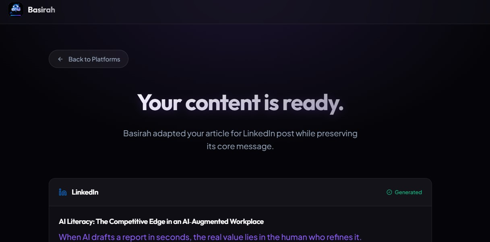
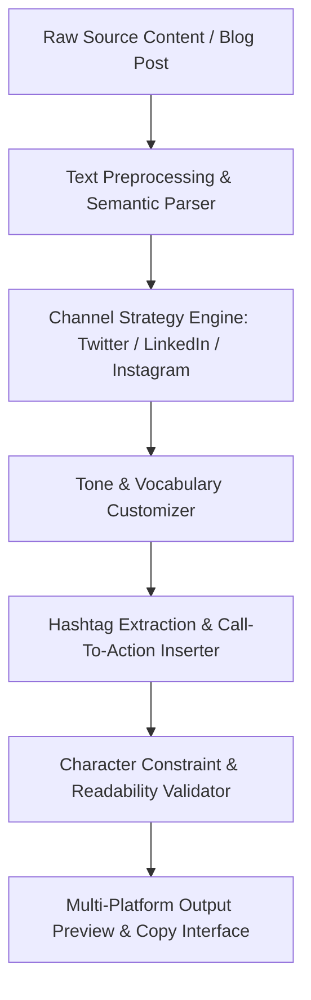

<div align="center">

<h1>Social Media Content Optimization & Rewriter</h1>


<p><strong>Channel-Specific Natural Language Processing Pipeline for Cross-Platform Social Publishing</strong></p>

<p>
  <a href="https://skillicons.dev"></a>
</p>

<p>
  <a href="#overview">Overview</a> &bull;
  <a href="#system-architecture">Architecture</a> &bull;
  <a href="#visual-showcase-gallery">Visual Gallery</a> &bull;
  <a href="#core-capabilities">Capabilities</a> &bull;
  <a href="#installation--setup">Installation</a> &bull;
  <a href="#author--contact-information">Author</a>
</p>

</div>

---
## Overview

The Social Media Content Rewriter optimizes source articles, notes, and updates into platform-tailored messages across LinkedIn, Twitter/X, Instagram, and Facebook. The system evaluates tone, keyword relevance, character limits, and hashtag placement to maximize organic engagement across social audiences.

---

## Visual Showcase Gallery

<table width="100%" align="center">
  <tr>
    <td width="50%" align="center"><b>Workspace Setup & Authentication</b><br><sub>Authentication portal and user project repository selection.</sub></td>
    <td width="50%" align="center"><b>Source Content Ingestion Studio</b><br><sub>Raw content intake with real-time text analysis.</sub></td>
  </tr>
  <tr>
    <td align="center"></td>
    <td align="center"></td>
  </tr>
  <tr>
    <td width="50%" align="center"><b>Audience Engagement Analysis</b><br><sub>Linguistic evaluation and sentiment metrics.</sub></td>
    <td width="50%" align="center"><b>Multi-Platform Variant Matrix</b><br><sub>Simultaneous generation of platform-specific messages.</sub></td>
  </tr>
  <tr>
    <td align="center"></td>
    <td align="center"></td>
  </tr>
  <tr>
    <td width="50%" align="center"><b>Twitter / X Thread Optimization</b><br><sub>280-character boundary segmentation and hashtag selection.</sub></td>
    <td width="50%" align="center"><b>LinkedIn Professional Article Formatter</b><br><sub>Long-form paragraph structuring with professional formatting.</sub></td>
  </tr>
  <tr>
    <td align="center"></td>
    <td align="center"></td>
  </tr>
  <tr>
    <td width="50%" align="center"><b>Newsletter & Email Digest Format</b><br><sub>Subject line optimization and body copy formatting.</sub></td>
    <td width="50%" align="center"><b>Variant Review & Copy Console</b><br><sub>One-click clipboard export and draft saving.</sub></td>
  </tr>
  <tr>
    <td align="center"></td>
    <td align="center"></td>
  </tr>
  <tr>
    <td colspan="2" align="center"><b>Application Workflow Dashboard</b><br><sub>Comprehensive view of saved drafts and published campaigns.</sub></td>
  </tr>
  <tr>
    <td colspan="2" align="center"></td>
  </tr>
</table>

---

## System Architecture



---

## Technology Stack

| Layer | Technologies |
| :--- | :--- |
| Frontend | React, TypeScript, Tailwind CSS, Lucide Icons |
| Backend Server | Node.js, Express, REST APIs |
| NLP & Parsing | Natural Language Processing Libraries |

---

## Installation & Setup

```bash
# Clone the repository
git clone https://github.com/sohailahmed-bsrh/social-media-content-rewriter.git
cd social-media-content-rewriter

# Install dependencies and start development server
npm install
npm run dev
```
---

## Author & Contact Information

<table width="100%" align="center">
  <tr>
    <td align="center" style="padding: 20px;">
      <h3>Sohail Ahmed</h3>
      <p><strong>Full-Stack Artificial Intelligence & Computer Vision Engineer</strong></p>
      <p>
        <a href="https://sohail.devsil.com"></a>
        <a href="https://github.com/sohailahmed-bsrh"></a>
        <a href="https://linkedin.com/in/sohail-ahmed-dev"></a>
        <a href="mailto:sohail.bsrh@gmail.com"></a>
      </p>
      <p><em>Available for technical roles in Artificial Intelligence, Computer Vision, and Full-Stack Engineering.</em></p>
      <hr style="border: 0; height: 1px; background: #30363d; margin: 15px 0;">
      <small>Repository: <code>sohailahmed-bsrh/social-media-content-rewriter</code> &bull; Distributed under the MIT License.</small>
    </td>
  </tr>
</table>
