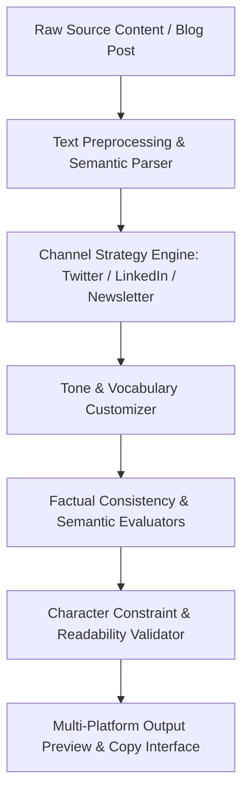
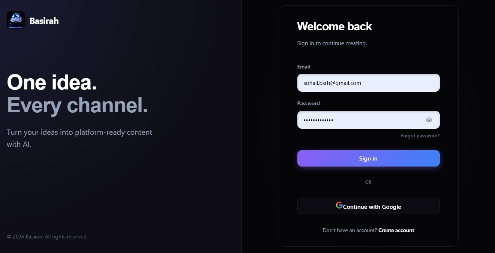

<div align="center">

<h1>Social Media Content Optimization & Rewriter</h1>


<p><strong>Channel-Specific Natural Language Processing Pipeline for Cross-Platform Social Publishing</strong></p>

<p>
  <a href="https://skillicons.dev"></a>
</p>

<p>
  <a href="#overview">Overview</a> &bull;
  <a href="#purpose--problem-statement">Purpose</a> &bull;
  <a href="#real-world-industry-applications">Use Cases</a> &bull;
  <a href="#step-by-step-engineering-walkthrough">How It Was Built</a> &bull;
  <a href="#system-architecture">Architecture</a> &bull;
  <a href="#visual-showcase-gallery">Visual Gallery</a> &bull;
  <a href="#technology-stack-matrix">Tech Stack</a> &bull;
  <a href="#installation--setup">Installation</a> &bull;
  <a href="#author--contact-information">Author</a>
</p>

</div>

---
## Overview

The Social Media Content Rewriter optimizes source articles, notes, and updates into platform-tailored messages across LinkedIn, Twitter/X, Instagram, and Newsletters. The system evaluates tone, keyword relevance, character limits, and hashtag placement to maximize organic engagement across social audiences while maintaining semantic factual consistency.

---

## Purpose & Problem Statement

### The Problem
Cross-posting the identical raw text across multiple social media platforms leads to low organic engagement. Twitter demands concise, hook-driven 280-character threads; LinkedIn requires professional spacing, executive tone, and corporate storytelling; Newsletters require informative subheadings and deep-dive context. Manually adapting a single long-form thought into 4 distinct platform formats is tedious and time-consuming.

### The Engineering Purpose
To build a full-stack content transformation system equipped with automated factual consistency evaluators, length validators, and tone metrics that translates long-form input text into platform-optimized variants in seconds.

---

## Real-World Industry Applications

- **Content Marketing Agencies**: Managing multi-client social calendars by converting single client blog posts into a week's worth of cross-platform social assets.
- **Executive Thought Leadership**: Founders and CTOs distilling complex technical architectures into accessible LinkedIn posts and viral Twitter/X threads.
- **Developer Advocacy & Tech Journalism**: Repurposing engineering changelogs and release notes into community discussion updates.
- **Newsletter Publishers**: Generating engaging preview summaries and teaser updates for subscriber broadcasts.

---

## Step-by-Step Engineering Walkthrough (How It Was Built)

### Step 1: Input Text Preprocessing & Entity Mapping
Raw source text is accepted via the React interface and sanitized on the backend (`server/src/ai/index.ts`). A tokenizer analyzes keyword density, core thesis statements, and domain terminology.

### Step 2: Specialized Platform Generators
The application routes the normalized text through specialized generation modules:
- **LinkedIn Generator (`linkedin.generator.ts`)**: Emphasizes career takeaways, structured line breaks, and professional discussion questions.
- **Twitter Generator (`twitter.generator.ts`)**: Derives numbered thread hooks, punchy observations, and relevant trending hashtag clusters within strict 280-character limits.
- **Newsletter Generator (`newsletter.generator.ts`)**: Synthesizes executive summaries, key bullet takeaways, and call-to-action sections.

### Step 3: Automated Quality Evaluators
Before returning output to the client, the backend runs evaluation checks:
- **Factual Consistency Evaluator (`factualConsistency.ts`)**: Verifies that generated claims do not contradict or fabricate facts missing from the source text.
- **Semantic Consistency Evaluator (`semanticConsistency.ts`)**: Measures cosine similarity of embeddings to ensure core thesis preservation.
- **Tone & Length Validators (`toneValidator.ts`, `lengthValidator.ts`)**: Enforces platform-specific lexical constraints and vocabulary formality.

### Step 4: High-Performance Inference via Groq Provider
The server utilizes Groq API infrastructure (`server/src/ai/providers/groq.provider.ts`) executing high-throughput LLaMA models, delivering completed multi-platform transformations with sub-second response times.

### Step 5: Full-Stack React & Tailwind Interface
The client application (`frontend/src/`) provides a clean split-screen editor where users can preview generated variants side-by-side, inspect quality evaluator metrics, and copy formatted text to the clipboard with one click.

---

## System Architecture



---

## Visual Showcase Gallery

<table width="100%" align="center">
  <tr>
    <td width="50%" align="center"><b>Workspace Setup & Authentication</b><br><sub>Authentication portal and user project repository selection.</sub></td>
    <td width="50%" align="center"><b>Source Content Ingestion Studio</b><br><sub>Raw content intake with real-time text analysis.</sub></td>
  </tr>
  <tr>
    <td align="center"></td>
    <td align="center"></td>
  </tr>
  <tr>
    <td width="50%" align="center"><b>Audience Engagement Analysis</b><br><sub>Linguistic evaluation and sentiment metrics.</sub></td>
    <td width="50%" align="center"><b>Multi-Platform Variant Matrix</b><br><sub>Simultaneous generation of platform-specific messages.</sub></td>
  </tr>
  <tr>
    <td align="center"></td>
    <td align="center"></td>
  </tr>
  <tr>
    <td width="50%" align="center"><b>Twitter / X Thread Optimization</b><br><sub>280-character boundary segmentation and hashtag selection.</sub></td>
    <td width="50%" align="center"><b>LinkedIn Professional Article Formatter</b><br><sub>Long-form paragraph structuring with professional formatting.</sub></td>
  </tr>
  <tr>
    <td align="center"></td>
    <td align="center"></td>
  </tr>
  <tr>
    <td width="50%" align="center"><b>Newsletter & Email Digest Format</b><br><sub>Subject line optimization and body copy formatting.</sub></td>
    <td width="50%" align="center"><b>Variant Review & Copy Console</b><br><sub>One-click clipboard export and draft saving.</sub></td>
  </tr>
  <tr>
    <td align="center"></td>
    <td align="center"></td>
  </tr>
  <tr>
    <td colspan="2" align="center"><b>Application Workflow Dashboard</b><br><sub>Comprehensive view of saved drafts and published campaigns.</sub></td>
  </tr>
  <tr>
    <td colspan="2" align="center"></td>
  </tr>
</table>

---

## Technology Stack Matrix

| Layer | Technologies | Version / Role | Engineering Purpose |
| :--- | :--- | :--- | :--- |
| Frontend | React, TypeScript, Vite | 18.2 / 5.0+ | Reactive editor, variant tabs, and responsive layout |
| Styling | Tailwind CSS | 3.4+ | Modular styling, dark mode, and UI typography |
| Backend Server | Node.js, Express, TypeScript | 20.x / 4.19+ | REST API gateway, evaluator pipelines, and auth middleware |
| AI Inference Engine | Groq Cloud SDK / LLaMA-3 | Latest | Ultra-low latency natural language text generation |
| Database & ORM | PostgreSQL / Prisma ORM | Latest | Relational draft persistence and user session caching |

---

## Installation & Setup

```bash
# Clone the repository
git clone https://github.com/sohailahmed-bsrh/social-media-content-rewriter.git
cd social-media-content-rewriter

# Install dependencies and start development server
npm install
npm run dev
```
---

## Author & Contact Information

<table width="100%">
  <tr>
    <td width="150" align="center" valign="middle">
      
    </td>
    <td>
      <h3>Sohail Ahmed</h3>
      <p><strong>Senior Software Engineer & AI Systems Architect</strong></p>
      <p>Specializing in Full-Stack AI Application Development, Computer Vision, Deep Learning Pipelines, and Scalable Automation Architectures.</p>
      <p>
        <a href="https://sohail.devsil.com"><strong>Portfolio Website</strong></a> | 
        <a href="https://github.com/sohailahmed-bsrh"><strong>GitHub Profile</strong></a> | 
        <a href="https://www.linkedin.com/in/sohail-ahmed-devsil/"><strong>LinkedIn</strong></a> | 
        <a href="https://www.kaggle.com/sohail2411126"><strong>Kaggle</strong></a> | 
        <a href="https://x.com/ahmed241126"><strong>Twitter/X</strong></a> | 
        <a href="mailto:se906403@gmail.com"><strong>Email Contact</strong></a>
      </p>
    </td>
  </tr>
</table>
