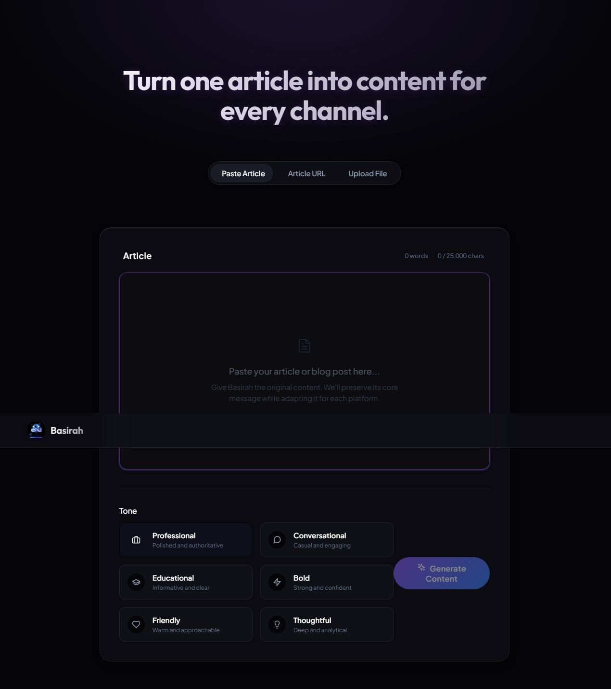
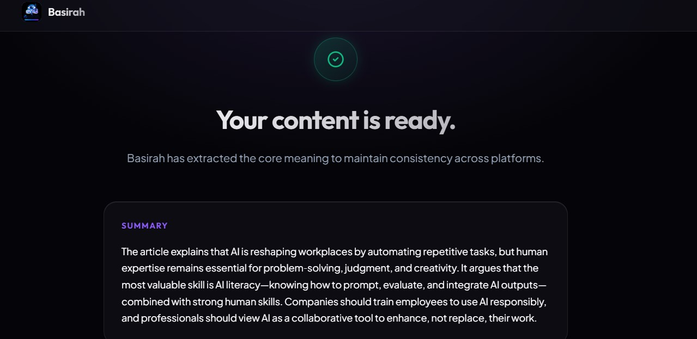
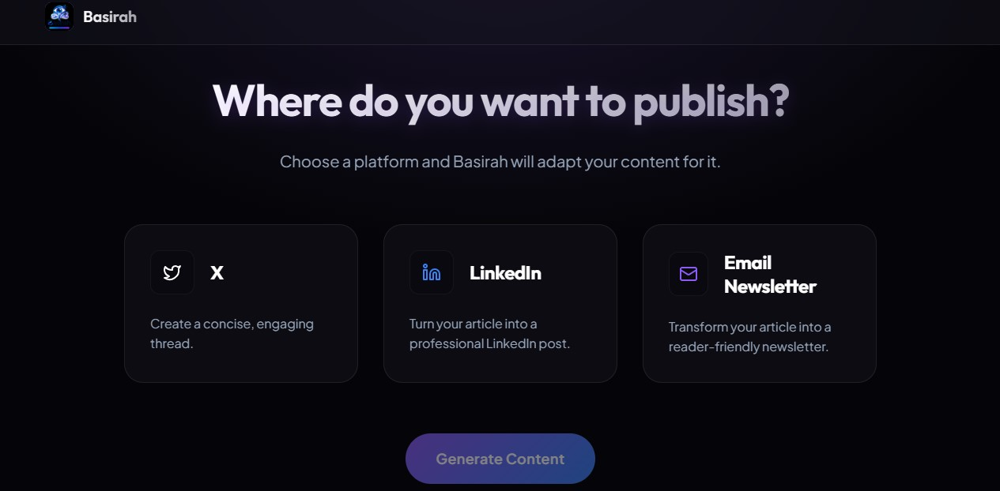
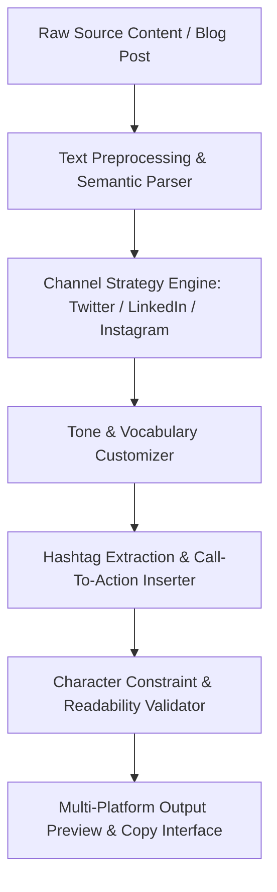

<div align="center">

<h1>Social Media Content Optimization & Rewriter</h1>


<p><strong>Channel-Specific Natural Language Processing Pipeline for Cross-Platform Social Publishing</strong></p>

<p>
  <a href="https://skillicons.dev"></a>
</p>

</div>

---

## Executive Summary

The Social Media Content Rewriter optimizes source articles, notes, and updates into platform-tailored messages across LinkedIn, Twitter/X, Instagram, and Facebook. The system evaluates tone, keyword relevance, character limits, and hashtag placement to maximize organic engagement across social audiences.

---

## Application Workflow Gallery

<table align="center">
  <tr>
    <td align="center"><b>Workspace Ingestion & Setup</b><br><sub>Source content intake and target platform selection.</sub></td>
    <td align="center"><b>Draft Editing & Tone Configuration</b><br><sub>Tone parametrization across professional, conversational, and technical.</sub></td>
  </tr>
  <tr>
    <td align="center"></td>
    <td align="center"></td>
  </tr>
  <tr>
    <td align="center"><b>Engagement Analysis & Scoring</b><br><sub>Predicted readability, sentiment metrics, and structure evaluation.</sub></td>
    <td align="center"><b>Platform-Specific Output Matrix</b><br><sub>Simultaneous generation of formatted posts tailored for each network.</sub></td>
  </tr>
  <tr>
    <td align="center"></td>
    <td align="center"></td>
  </tr>
</table>

---

## System Architecture



---

## Technology Stack

| Layer | Technologies |
| :--- | :--- |
| Frontend | React, TypeScript, Tailwind CSS, Lucide Icons |
| Backend Server | Node.js, Express, REST APIs |
| NLP & Parsing | Natural Language Processing Libraries |

---

## Installation & Setup

```bash
# Clone the repository
git clone https://github.com/sohailahmed-bsrh/social-media-content-rewriter.git
cd social-media-content-rewriter

# Install dependencies and start development server
npm install
npm run dev
```

---

## Author & License

- **Author**: Sohail Ahmed ([Portfolio](https://sohail.devsil.com) | [GitHub](https://github.com/sohailahmed-bsrh))
- **License**: Distributed under the MIT License.
