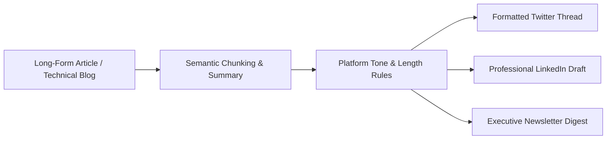

# Social Media Content Transformation Engine

> Natural language rewriting architecture adapting long-form articles into platform-optimized social posts.

[](https://github.com/sohailahmed-bsrh/social-media-content-rewriter)
[](https://sohail.devsil.com/projects.html)
[](https://sohail.devsil.com)

---

## Overview

Repurposing technical articles into punchy LinkedIn posts, concise tweets, and newsletter summaries is tedious and inconsistent.

This project provides an end-to-end, reproducible implementation engineered to solve this challenge through verified data transformations, robust algorithms, and production-ready architecture.

---

## Key Features

- Structured multi-platform prompt architecture retaining core technical meaning while adapting tone
- Automatic thread generation breaking long content into coherent sequential posts
- Hashtag and hook generation tuned to algorithmic engagement criteria
- React/Vite interactive editor with real-time character count limits

---

## System Architecture



---

## Technology Stack

| Technology | Version / Spec | Role in Architecture |
| :--- | :--- | :--- |
| **React & Vite** | `18.2+` | Modern content drafting interface with live preview |
| **Node.js & Express** | `18+` | Text processing API and LLM connectors |
| **Tailwind CSS** | `3.3+` | Clean editorial layout |

---

## Repository Structure

```text
social-media-content-rewriter/
|-- frontend/
|   |-- src/
|   `-- package.json
|-- .env.example
|-- .gitignore
`-- README.md
```

---

## Installation and Execution

### Prerequisites
- Node.js 18+ / Python 3.10+
- Git version control

### Setup Instructions
1. Clone the repository:
```bash
git clone https://github.com/sohailahmed-bsrh/social-media-content-rewriter.git
cd social-media-content-rewriter
```

2. Configure environment and dependencies:
```bash
cd frontend && npm install
npm run dev
```

---

## Interface and Verification
The system produces verifiable execution logs, prediction matrices, or interactive browser interfaces depending on the target mode. Verify operation by executing the commands specified above or inspecting the demonstration notebooks.

---

## Author and Contact
Developed by **Sohail Ahmed** — Full Stack AI Engineer & Machine Learning Specialist.
- **Portfolio:** [sohail.devsil.com](https://sohail.devsil.com)
- **GitHub:** [@sohailahmed-bsrh](https://github.com/sohailahmed-bsrh)
- **Email:** [sohail.bsrh@gmail.com](mailto:sohail.bsrh@gmail.com)
