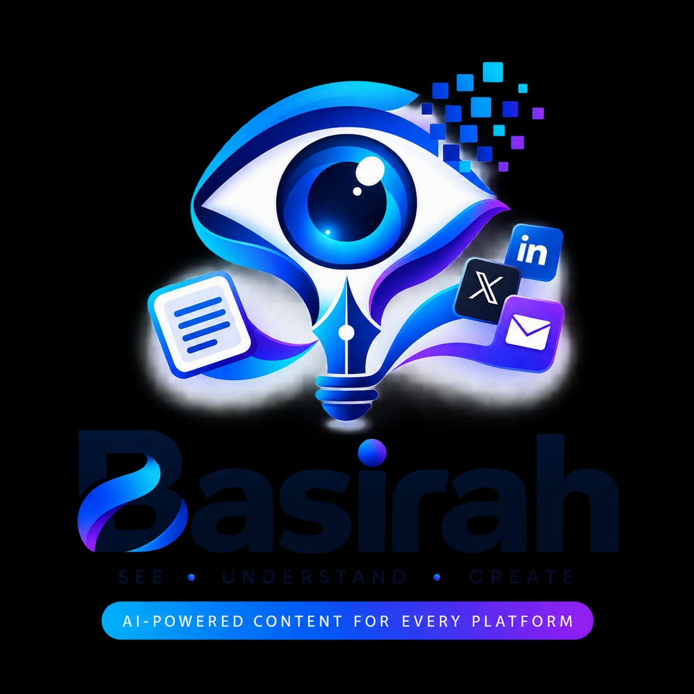
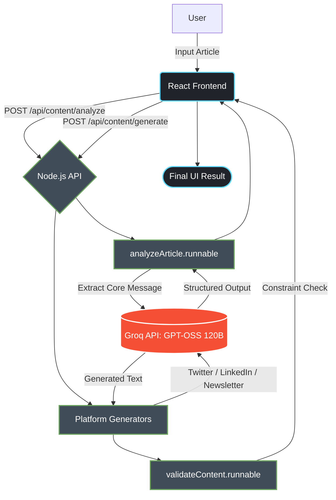
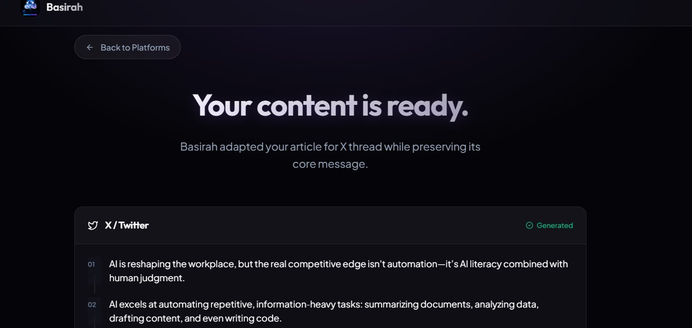
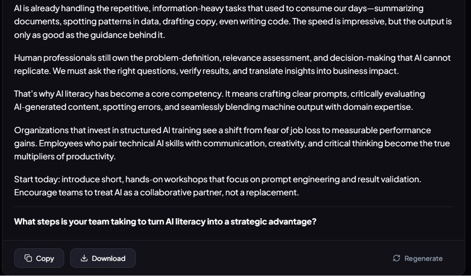
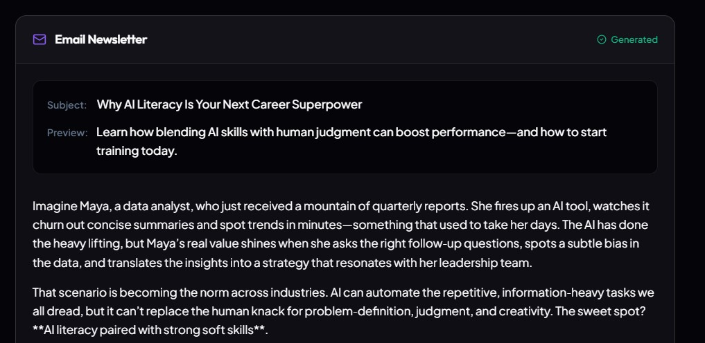

<div align="center">
  
  
  <br />
  

  <h1 style="margin-top: 20px; font-size: 3.5rem; font-weight: 900; letter-spacing: -1px;">Basirah</h1>
  
  <div style="background: rgba(255, 255, 255, 0.05); border: 1px solid rgba(255, 255, 255, 0.1); border-radius: 12px; padding: 15px 30px; display: inline-block; margin-bottom: 20px;">
    <h2><b>AI-Powered Social Media Content Rewriter</b></h2>
    <p style="font-size: 1.1rem;"><b>Transform a single source article into platform-optimized, high-performing content for X, LinkedIn, and Email Newsletters.</b></p>
  </div>
  
  <br />

  <p>
    Built by <b>Sohail Ahmed</b> <br />
    <a href="https://sohil.devsil.com"><b>🌍 Portfolio</b></a> •
    <a href="https://github.com/sohail-ahmed-26"><b>🐙 GitHub</b></a> •
    <a href="https://linkedin.com/in/sohail-ahmed-devsil"><b>💼 LinkedIn</b></a>
  </p>

  <br />

  <!-- Premium Original Tech Stack Icons -->
  <p>
    
    
    
    
    
    
    
  </p>
</div>

---

## 📖 Overview

Basirah is a specialized Generative AI SaaS application that intelligently transforms long-form content into highly optimized, platform-native social media posts. Rather than relying on simple, generic text summarization, Basirah uses a multi-step AI orchestration pipeline to deeply understand the core message of your source material, and then meticulously rewrites it to match the constraints, tone, and audience expectations of X (Twitter), LinkedIn, and Email Newsletters.

## ⚠️ The Problem

Content creators and businesses waste countless hours manually adapting a single article for multiple distribution channels. Each platform has distinct requirements:
- **X (Twitter)** demands concise, engaging, thread-based structures under strict character limits.
- **LinkedIn** favors professional, insight-driven posts with strategic spacing for readability.
- **Newsletters** require clear subjects, preview text, and structured body content.

Cross-posting identical content across these platforms severely limits engagement. Manual adaptation is tedious and doesn't scale.

## 💡 The Solution

Basirah eliminates this friction through a robust **Generative AI Pipeline**. By separating *Content Understanding* from *Platform Generation*, the system ensures the foundational meaning and key facts are preserved, while the structural delivery is perfectly tailored to the destination platform's unique algorithm and audience.

---

## 🔄 How It Works (User Workflow)

1. **Sign In**: Access the platform through a polished authentication portal.
2. **Add Source Article**: Paste your long-form article. The editor tracks words and characters in real-time.
3. **Analyze Content**: The AI digests the article, extracting the core message to guarantee consistency.
4. **Choose Tone**: Condition the AI with your preferred voice (e.g., Professional, Conversational, Bold).
5. **Select Platform**: Choose your target distribution channel (X, LinkedIn, or Email Newsletter).
6. **AI Generation**: Basirah adapts the content into a ready-to-publish format.
7. **Copy & Publish**: Review the results and instantly copy them to your clipboard.

---

## 🧠 Generative AI Pipeline

Basirah employs advanced AI engineering concepts to ensure high-quality output, avoiding the pitfalls of single "zero-shot" prompts.

### 1. Content Understanding (`analyzeArticle.runnable`)
The source material is first analyzed. The AI extracts the **Summary**, **Core Message**, and **Key Points**. This creates a structured, ground-truth representation of the content, ensuring the final output doesn't hallucinate or lose the original meaning.

### 2. Tone Conditioning
User-selected tones are injected into the system prompt as dynamic stylistic guidelines, overriding default AI verbosity.

### 3. Platform Adaptation (`generators/`)
The structured understanding is passed to isolated, platform-specific generators. Each generator contains highly tuned instructions:
- **Twitter Generator**: Enforces thread structures, hook optimization, and strict character limits.
- **LinkedIn Generator**: Enforces professional language, actionable insights, and optimal line-spacing.
- **Newsletter Generator**: Structures the output with a compelling Subject, Preview, Body, and Call-to-Action.

### 4. Validation (`validateContent.runnable`)
The generated text is programmatically evaluated to ensure it meets the target platform's structural constraints before being returned to the user.

---

## 🏗 Architecture



---

## 💻 Tech Stack

### Frontend
- **React**: Component-based UI architecture.
- **TypeScript**: Strict type-safety across the application.
- **Vite**: Ultra-fast build tooling and development server.
- **Custom CSS Modules**: A meticulously crafted "Cosmic Neon" glassmorphism design system built without heavy utility frameworks.

### Backend & AI
- **Node.js & Express**: Fast, lightweight API routing.
- **Groq SDK**: Ultra-low latency inference API.
- **Model**: `openai/gpt-oss-120b`.
- **Runnable Architecture**: Modular, decoupled AI pipeline scripts.

---

## 📸 Application Screenshots

<div align="center">
  <p><b>01. Authentication</b> ➔ <b>02. Article Input</b> ➔ <b>03. Content Analysis</b></p>
  
  
  
</div>
<br>
<div align="center">
  <p><b>04. Platform Selection</b> ➔ <b>05. X (Twitter) Result 1</b> ➔ <b>06. X (Twitter) Result 2</b></p>
  
  
  
</div>
<br>
<div align="center">
  <p><b>07. LinkedIn Result 1</b> ➔ <b>08. LinkedIn Result 2</b> ➔ <b>09. Email Newsletter</b></p>
  
  
  
</div>

---

## ⚡ Engineering Highlights

- **Runnable-Based Orchestration**: The backend AI logic relies on isolated "runnables", ensuring that analysis, generation, and validation are decoupled, highly testable, and maintainable.
- **Platform-Specific Generators**: Distinct TypeScript files handle the exact prompt structure for different platforms, completely avoiding generic, multi-purpose prompts that dilute output quality.
- **Frontend/Backend Separation**: Clean separation of concerns with an independent React SPA communicating with an Express JSON API.
- **Premium CSS Architecture**: Employs CSS modules utilizing a robust set of CSS variables (`var(--glass-bg)`, `--color-primary-accent`) to enforce a highly consistent design system without third-party utility libraries.
- **Security**: The `GROQ_API_KEY` is securely stored in the Node.js backend environment variables (`.env`). The React frontend never touches the API keys, preventing exposure in the browser.

---

## 🚀 Getting Started

### Prerequisites
- Node.js (v18 or higher)
- npm or yarn
- A valid Groq API Key

### Installation

1. **Clone the repository**
   ```bash
   git clone https://github.com/yourusername/basirah.git
   cd basirah
   ```

2. **Backend Setup**
   ```bash
   cd server
   npm install
   ```
   Create a `.env` file in the `server` directory and add your credentials:
   ```env
   PORT=5000
   NODE_ENV=development
   GROQ_API_KEY=your_groq_api_key_here
   GROQ_MODEL=openai/gpt-oss-120b
   ```

3. **Frontend Setup**
   ```bash
   cd ../frontend
   npm install
   ```

### Running the Application

Open two separate terminal windows.

**Terminal 1 (Backend):**
```bash
cd server
npm run dev
```

**Terminal 2 (Frontend):**
```bash
cd frontend
npm run dev
```
The application will be available at `http://localhost:5173`.

---

## 👨‍💻 Author

<div align="center">
  
  <h2><b>Sohail Ahmed</b></h2>
  <p><b>Software Engineer & AI Enthusiast</b></p>
  <p><i>Specializing in Generative AI, Frontend Architecture, and Seamless User Experiences.</i></p>
  <br />
  <p>
    <a href="https://sohil.devsil.com"><b>🌍 Portfolio</b></a> • 
    <a href="https://github.com/sohail-ahmed-26"><b>🐙 GitHub</b></a> • 
    <a href="https://linkedin.com/in/sohail-ahmed-devsil"><b>💼 LinkedIn</b></a>
  </p>
</div>

---

<div align="center">
  
  <br>
  <i>Designed and engineered for the modern AI web.</i>
</div>
